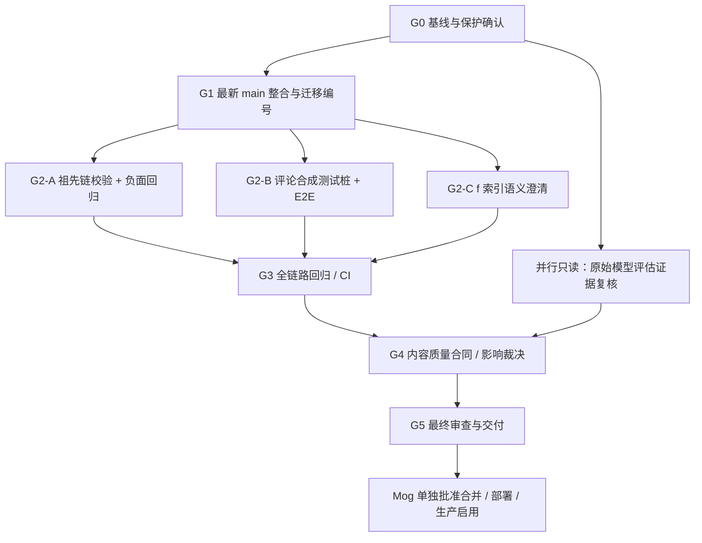

# Intelligence · PR #576 单次主题研究收口实施手册

> 版本：V1.0  ·  编制日期：2026-11-13  ·  工作包：`PR576-SINGLE-PASS-CLOSEOUT`
> 执行对象：本地 Agent（协调/实施/审查）  ·  仓库：`Himog0921/linggan-intelligence`  ·  原 PR：https://github.com/Himog0921/linggan-intelligence/pull/576
> 本文件是**执行指令和验收合同**，不是已完成代码、测试或部署的证明。执行时必须更新基线，不能把本文件中的历史快照视为最新状态。

> 状态: 活跃计划
> 最后核对: 2026-11-12
> 适用范围: PR #576 `topic-map.single-pass.v1` 收口（G0–G5）及原分支交付
> 事实来源: 本手册、`origin/main@b1df0056`、PR #576 审查评论与隔离验证输出
> 冲突时以谁为准: Mog 当前确认、AGENTS.md、真实运行/数据库/代码与现行合同

## 0. 给执行 Agent 的开工指令

**任务目标**：在**原 PR #576** 上收口 `topic-map.single-pass.v1`：修复已经证实的祖先链校验漏洞；修复评论模式合成测试桩，使真实 React→Axum→PostgreSQL→executor→SDK 的端到端证明通过；整合最新 `main` 及迁移顺序；完成与影响相称的全链路回归、48 文件变更审查和 PR 合并前交付。**不推倒 single-pass 设计，不新增模型审批层，不顺手实现主题图谱的大规模业务重构。**

按本手册执行 `G0 → G1 → G2 → G3 → G4 → G5`，每个 Gate 给出证据后才能进入依赖它的下一个阶段。可以并行进行**只读审查**；写入原 PR 的分支始终只有一个负责集成的 Agent。工作中发现新的确凿风险，先记录影响和可复现证据，再判断是否属于本 PR 的合并阻塞项；不能靠猜测持续扩围。

**授权边界**：允许在符合本机约束的独立 worktree 中修改、提交、推送代码至原 PR 分支，运行本地/CI 隔离验证，更新 PR 审查回复。**不自动合并 PR，不部署，不执行生产迁移，不启用生产模型任务，不调用收费真实模型，不写入/删除生产数据。**这些动作需要 Mog 的明确授权。不要碰 `runtime-main`。

**最终成功输出**：原 PR 可合并候选提交 SHA、通过的最终检查 URL、负面用例结果、变更范围核对、风险清单、尚未执行的生产验收事项，以及一句明确状态：`Implemented` / `Tested` / `Merge-ready`；只有实际发生合并/部署/生产验收后才能声明相应状态。

---

## 1. 项目背景、目标与不变项

### 1.1 为什么做本次工作

PR #576 将主题研究的新任务从四阶段 AI 调用改为一次 AI 调用，合同为 `topic-map.single-pass.v1`，模式为：

- `author`：消费已保存 Content Core，形成讨论投影并归入现有/新主题；
- `comment`：消费已有评论语义信号，仅归属已有主题，不创建主题；
- `reassignment`：复用已保存讨论，在主题定义变化后重新判断归属，不重做作者投影。

历史冻结的 `legacy_four_stage` 执行分支必须保留。项目采用 Rust 后端、PostgreSQL、React + TypeScript strict 前端。用户已确定：内容理解 L1 一次生成、L2 按需触发；不能将模型语义质量问题偷换成固定数量阈值，也不能用合成链路成功冒充真实模型质量。

### 1.2 本 PR 的成功标准

1. 新任务三种模式在确定性合同、隔离端到端和历史兼容范围内工作正常。
2. 新主题的**整条祖先链**在落库前完成必要的确定性校验，错误祖先链不能产生任何可见主题或关系。
3. 旧四阶段冻结任务可继续执行/读取；已有定义和归属不会因迁移被静默替换。
4. 最终 PR 基于最新 `main`，迁移顺序唯一且完整，最终 CI 必需检查通过。
5. 对真实模型质量边界给出可核对的结论；无原始证据则明确“未验证”，不为了通过检查增加无法解释的规则。

### 1.3 必须保持的不变项

- 保持 `author` / `comment` / `reassignment` 业务边界。
- 不把评论者观点改称作者观点；图片上的模型观察不能称为 OCR 逐字原话。
- 作者 `Core` 只发送一份；评论/重归不重新生成 Core。
- 已有主题定义版本、候选资格、精确引用、失败回滚、幂等和重新归属语义保留。
- 不修改项目整体技术栈、视觉规范、导航、登录及其他无关模块。
- 不增加第二次模型审查、自动修复循环、置信度门槛、固定最少 discussion 或主题数。

---

## 2. 已知基线、证据等级与待查事实

### 2.1 2026-11-13 复核快照（执行时必须重查）

| 事项 | 快照 | 证据与边界 |
| --- | --- | --- |
| PR | #576，Open，尚未合并 | GitHub PR 元信息 |
| PR head | `021b5303a31ba68d038e7e4e29e3e1dde0397134` | 执行时重新 `gh pr view` / `git ls-remote` |
| 主干差异 | PR 超前 2 提交、落后 main 6 提交 | 连接器 compare；未来可能改变 |
| 审查线程 | 1 条未解决 P2，`single_pass.rs` 原 325–327 行 | https://github.com/Himog0921/linggan-intelligence/pull/576#discussion_r4548057070 |
| Topic Map core proof | 最后一次已知成功 | CI run `43184310518`，不是未来提交的通行证 |
| Delivery | 已知失败 | CI run `43184310522`；`unified_research_real_chain_browser_proof` |
| 迁移编号 | main 已有 `0203`—`0206`，PR 有 `0203_topic_single_pass` | **不同 migration_id，编号/顺序与共享文件整合问题，不是同名 ID 冲突** |
| mergeable | 连接器返回 false | 具体 Git 冲突需由本地实际 merge 确认，不可据此断言全部冲突块 |
| 修改面 | 48 个文件 | 只代表 PR 当前差异数量；收口要对最终差异重新核实 |

#### 需要保留的源链接

- PR：https://github.com/Himog0921/linggan-intelligence/pull/576
- 审查线程：https://github.com/Himog0921/linggan-intelligence/pull/576#discussion_r4548057070
- 核心 CI：https://github.com/Himog0921/linggan-intelligence/actions/runs/43184310518
- 失败 Delivery：https://github.com/Himog0921/linggan-intelligence/actions/runs/43184310522
- comment 模式评估：https://github.com/Himog0921/linggan-intelligence/pull/576#issuecomment-6819033354
- author 模式评估：https://github.com/Himog0921/linggan-intelligence/pull/576#issuecomment-6822491467
- author+comment 构造探针：https://github.com/Himog0921/linggan-intelligence/pull/576#issuecomment-6823094176

### 2.2 证据分级与风险清单

| ID | 等级 | 判断 | 所需行动 |
| --- | --- | --- | --- |
| E-01 | 已证实：代码路径 | `ProposedParent.ancestor` 不执行完整递归业务校验，`accept_parent()` 递归保存；DB 仅保证条件数组数量，不校验交叉重复 | G2 修复并补红绿回归 |
| E-02 | 已证实：CI 失败 | 评论挂靠 E2E 失败；合成服务 `topic_response()` 只对 `author` 构造单次结果，对 comment 走通用输出，触发 `output_schema_invalid` | G2 修复合成测试桩，G3 跑完整 E2E |
| E-03 | 已证实：集成状态 | PR 分支落后 main，`full_schema_fixture.rs` 与 `local-runtime.sh` 同时变更，迁移编号次序不再一致 | G1 整合最新 main 并调整编号 |
| E-04 | 已证实：静态合同缺口 | `validate_output` 只检查已有讨论，未检查每个 `Core.knowledgeUnit` 的处理去向 | G4 评估业务影响，**不默认增加数量下限** |
| E-05 | 部分证实 | `f` 代码使用 0-based；真实模型是否频繁误读、比例多少只见作者汇总，原始输出未独立核对 | G2 明确提示词，G4 评估回包 |
| E-06 | 待验证 | 作者新主题同义归并、边界摇摆、E3 定义原因、真实目录复用率 | G4 用原始输出与真实目录检验 |
| E-07 | 待验证 | 生产环境是否已有坏祖先/生产实际启用状态 | 不擅自连接生产；只读检查需单独授权 |

> 重要：**静态代码路径证明缺少防线，不等于生产已经写入坏数据。** 同样，合成 CI 通过不代表 DeepSeek 语义质量达标。

---

## 3. 组织编排、依赖和写入权

### 3.1 单写入责任模型

| 角色 | 责任 | 可写范围 |
| --- | --- | --- |
| Agent A：Coordinator / Integrator | 基线、分支整合、提交、推送、CI 收口、最终报告 | 唯一有权将更改推至 PR 原分支 |
| Agent B：Core Reviewer | 祖先链校验独立审查、失败场景设计、历史兼容回归审核 | 默认只读；可给补丁建议，不直接推 PR |
| Agent C：QA / Evidence Reviewer | CI 日志定位、48 文件变更审计、样本/证据质量复核 | 默认只读；不得使用生产凭据或改配置 |

当只有一个 Agent 时，按 Gate 顺序完成全部工作；无需为形式上的角色分工制造额外 worktree。并行只安排不互相依赖的**只读工作**，例如 G0 的 CI 诊断与迁移冲突调查。若确需两名编码 Agent，必须分别在自己可辨识的 worktree 上完成**不重叠文件**，由 A 审阅后按提交纳入，禁止同时在 PR 分支改写或 force push。

### 3.2 Gate 依赖图



G2 三项之间代码位置可部分独立，但**提交与 PR 更新统一由 A 编排**。G4 的原始评估复核可与 G1–G3 并行做只读整理；涉及 Prompt/Schema 的产品新规则不得越过 G4 决策点直接编码。

### 3.3 每个 Gate 的最小回执

`Gate 名称 | 基线 SHA | 修改文件 | 执行命令或核查方法 | 通过/失败 | 日志或测试 URL | 遗留风险 | 下一步`。不写“测试已通过”除非有具体执行结果。只对受影响范围验证；只有最终 Gate 才要求完整合并检查。

---

## 4. G0 · 开工审计与安全工作树（必须第一个执行）

**目标**：将执行建立在可证实的当前仓库状态上，不破坏其他 Agent 的工作。

### 4.1 操作

1. 只允许在 `~/proma/linggan-intelligence` 及其 `.worktrees/` 内工作。不得在 `~/Documents/ChatGPT/内容情报系统/linggan-intelligence` 创建任何副本。
2. 检查 `git status --porcelain`、`git worktree list --porcelain`、已有任务进程和 PR 分支占用。遇到未知未提交更改不重置、不清理、不覆盖。
3. `git fetch origin main codex/topic-map-single-pass-20261111`，读取当前 `main` 与 PR head 的 SHA、PR 评论和审查线程、必需 CI 状态与变更文件清单。
4. 用 `gh pr checks 576` 和最新 run 的失败日志校对失败原因；不得把历史成功 run 当成新提交的成功。
5. 检查 `database/migrations/` 及正式迁移登记的最新可用编号。**2026-11-13 的候选是 0207，但执行时要动态判断。**
6. 由 A 创建**自己专用**的独立 worktree 和本地工作分支，基于远端 PR head 开始，不在别的 Agent 工作树直接编辑。不重克隆仓库。

参考命令（需要先确认目标路径不存在且没有他人占用）：

```bash
cd ~/proma/linggan-intelligence
git status --porcelain
git worktree list --porcelain
git fetch origin main codex/topic-map-single-pass-20261111
git rev-parse origin/main
git rev-parse origin/codex/topic-map-single-pass-20261111
gh pr view 576 --json headRefName,headRefOid,baseRefName,state,mergeable,updatedAt
gh pr checks 576
git worktree add -b codex/pr576-closeout-20261113 \
  .worktrees/pr576-closeout-20261113 \
  origin/codex/topic-map-single-pass-20261111
```

若已有 Agent 使用所建议目录或分支，不覆盖，改用未占用名称并在回执登记。Rust 编译使用本任务独立的 `CARGO_TARGET_DIR`，如 `/tmp/pr576-closeout-target`；实际路径须确认不存在其他用户数据。

### 4.2 Gate G0 通过条件

- [ ] 记录当前 main SHA、PR head SHA、merge-base、CI 失败 run、未解决 review thread。
- [ ] 记录每个工作树所属者、是否有未提交更改和进程占用。
- [ ] 建立 `artifacts/private/pr576-closeout-20261113/` 证据目录，不将原始回包/个人数据提交 Git。
- [ ] 确认本任务是唯一推送 PR 的写入者；发现竞争写入时停止 push、先重新核对远端 head。

**停止条件**：原 PR 已合并或关闭、工作树不安全、远端 head 非预期变化、或必须使用生产目录才能继续。改为报告差异，不强行执行。

---

## 5. G1 · 主干整合与迁移顺序修复（所有代码修复的前置项）

**目标**：避免旧基线测试绿灯、合并后才出现迁移冲突。数据库迁移属于高风险整合，必须先建隔离验证。

### 5.1 操作顺序

1. 在 A 的工作分支上将最新 `origin/main` **合并**进来。优先保留已有 PR 历史；禁止强制重置或 force push。
2. 对实际出现的冲突逐块合并，不使用无差别 `-X ours`/`-X theirs`。重点是：
   - `apps/api/src/local_web/full_schema_fixture.rs`
   - `scripts/local-runtime.sh`
3. 对 `database/migrations/0203_topic_single_pass.sql`：核对 main 已占用的迁移序号，选取当前**下一个**可用序号；在 2026-11-13 快照下为 `0207_topic_single_pass.sql`。按真实新增迁移内容和顺序更新以下全部引用：
   - SQL 文件本身的实际文件路径；
   - `scripts/local-runtime.sh` 中 `apply_migration_once` 的登记和调用顺序；
   - `apps/api/src/local_web/full_schema_fixture.rs` 的 `include_str!` 和迁移登记 ID；
   - `full_schema_fixture.rs` 中与该 SQL 字节内容匹配的 SHA-256；
   - `scripts/ci-select.mjs` 的受影响路径；
   - 其他通过 `rg '0203_topic_single_pass|0207_topic_single_pass'` 找到的引用。
4. **保留** main 原有 `0203_opportunity_metric_definition`、`0204_opportunity_comment_eligibility`、`0205_opportunity_problem_taxonomy`、`0206_comment_platform_time` 等迁移，不为通过测试删除或跳过任何 main 迁移。
5. 核对改名后的 `topic_research` 配置迁移在**全新数据库**和**已应用 main 历史迁移的隔离数据库**中均按顺序正常执行。验证二次启动不会重复切换配置。不可访问隔离数据库时，在 Gate 回执中标记“未验证”，不能代替成功。
6. 检查历史冻结窗口的 `configurations` 长度仍为4，新窗口为1；生产设置切换只发生在迁移实际执行时，不被编译/测试自动误当成生产启用。

建议整合策略：独立工作分支执行 `git merge --no-ff origin/main`；整理冲突与迁移之后执行最小的迁移/编译验证，再进入 G2。若 0207 已被主干占用，重新计算编号，绝不盲用。

### 5.2 Gate G1 验收

- [ ] `git diff --check` 通过，无未解释冲突标记。
- [ ] 迁移文件唯一、调用顺序正确，`full_schema_fixture` 包含 main 全量迁移和 PR 新迁移。
- [ ] 迁移哈希与文件实际字节一致；先前存在的 migration_id 不被修改。
- [ ] 新建库/升级库隔离测试结果分别记录；没有生产迁移。
- [ ] 写明合并 main 的 commit SHA、冲突文件、解决方式和理由。

**停止条件**：迁移历史在目标库可能已经分叉、SQL 需要危险的 DROP/数据迁移、测试将触碰非隔离数据库，或冲突超出本 PR 功能范围。先做影响分析和回滚方案，交 Mog 处理高风险产品/数据决策。

---

## 6. G2 · 只修复已证实的三个问题

### G2-A · 祖先链完整校验（代码缺陷，合并阻塞）

**关键文件**：

- `crates/intelligence/src/ai_foundation/topic_research_packet/single_pass.rs`：`proposed_topics()`、`build_topic()`、`build_parent()`；
- `crates/intelligence/src/topic_map_research_analysis/resolution.rs`：`validate_resolution()`、`validate_parent()`、`validate_parent_candidate_reuse()`；
- `crates/intelligence/src/topic_map_core/acceptance.rs`：`accept_parent()`；
- `database/migrations/0120_topic_map_core.sql`：`linggan_topic_map_concept_rule` 的数量约束；
- `crates/intelligence/src/ai_foundation/topic_research_packet/single_pass/tests.rs` 与 PostgreSQL 验证文件。

**先构造红测，再改实现**：模型返回 `n1 → n2 → n3`，仅 discussion 引用 `n1`。让 `n3` 的 inclusion/exclusion 相同，或 `n3` 与 `n2` 定义相同，验证当前代码能通过部分校验（若测试预期和现状不同，先停止重新定位）。

**推荐最小修复**：

1. 让 `validate_resolution()` 在一次处理里校验所引用 `ProposedTopic` 的每一条 `parent → ancestor` 边；复用现有 `validate_concept`、`validate_criteria`、概念身份比较与候选版本检查，不复制第二套规则。
2. 逐层检查 root/existing/proposed 的字段形状和互斥性、`reason`、合法候选的当前 definitionRef、同名/同概念父子冲突、与已有候选**完全相同身份**的复用冲突。
3. 对 `existing` 祖先检查有效候选与准确版本；不能要求它像直接 decision 一样凭空带 `relations` 字段。`newTopic` 已声明的父级边可由内部合同表达包含关系；需要保留已验证的关系语义，不能误改原 schema。
4. 对整条链保持无环检测与合法 root 终止，防止因不完整结构导致空节点入库。原 `build_topic()` 已能检查本地 newTopicId 循环；不要误删。
5. 非法链必须在任何数据库写入前拒绝。acceptance 的事务回滚仍然保留，作为防线；不能把 DB rollback 当成对模型语义的验证。
6. **确定性检查边界**：只验证字面/结构/版本/完全相同概念身份等程序能够证明的规则。不能声称程序已经证明“父主题在语义上一定包含子主题”；该类问题属于 G4 实际语义评估，不增加另一层模型审批。

**必备测试矩阵**：

| 用例 | 预期 |
| --- | --- |
| n3 纳入/排除重复，n1 唯一被直接引用 | 拒绝，定位到祖先条件 |
| n3 和 n2 具有相同概念身份 | 拒绝 |
| n3 与目录现有候选完全同身份 | 拒绝重复创建，提示复用 |
| n3 指向过期或不在候选目录的 existing 定义 | 拒绝 |
| n2 与 n1 同名/同概念 | 拒绝 |
| n1→n2→n3→root 合法多层新主题 | 通过、父级关系正确 |
| n1→n2→existing 合法组合 | 通过，关系/版本正确 |
| newTopicId 环与无效引用 | 拒绝，保留现有测试 |
| 非法输出经 executor/acceptance | `linggan_topic_*` 相关写入为0，无部分结果 |
| 旧版单层/历史四阶段合法输出 | 与修复前结果兼容 |

**G2-A Gate**：红测证实缺陷 → 修复后绿测 → 最小 PostgreSQL 事务回归 → 旧模式回归；附失败码与 commit SHA。不得“只改规则，不加测试”。

### G2-B · 修复 comment 模式合成服务/E2E（CI 阻塞）

**已知失败**：Delivery run `43184310522` 的 `web-real-chain / real-chain-core`，`unified_research_real_chain_browser_proof` 在评论主题挂靠步骤失败。两条评论状态为 `failed`，模型调用记录 `ai_output_invalid / output_schema_invalid`。

**根因定位**：`crates/intelligence/tests/support/ai_writing_endpoint.rs` 的 `topic_response()` 在 `topic-map.single-pass.v1` 分支只接受 `mode == author`；`mode == comment` 返回 `None`，落入通用写作结果。其 JSON 不满足 single-pass 合同。这个定位说明**测试桩未适配**，不等于已经证明生产 comment 模式有相同错误。

**实施**：

1. 为合成端点增加 `comment` 模式，严格生成 `contract=topic-map.single-pass.v1`、`projection=null`、`newTopics=[]`、逐 `input.units.discussionIndex` 返回 decision、`newTopicId=null`、`relations=[]`。
2. 用测试已有真实候选定义生成有证据的 `matched`；没有候选或不匹配时返回 `uncertain`/`out_of_scope`，不能凭空造新主题。若合成输入是两个相同语义信号，允许两条各自有效归属，不能省略某个 discussion。
3. 额外覆盖 `reassignment` 合成分支（生产合同已存在，但现有 E2E 主路径未验证），避免下次相同漏项。
4. 不调整生产验证器来容忍测试桩的通用写作 JSON；不把 `output_schema_invalid` 自动转成成功。
5. 验证从前端触发后，评论各自 `assignmentState=complete`、原始评论回链正确；对无匹配情况正确保留未归属。

**G2-B Gate**：先运行聚焦合成测试，再运行 `unified_research_real_chain_browser_proof`。整条 `React → Axum → PG → executor → 合成模型 → acceptance → UI 回链` 通过；截图/日志只说明合成链路有效。

### G2-C · `f` 的 0-based 语义明确化（低风险合同表达）

已知 `fragments` 由 `enumerate()` 产生 `fragmentIndex=0,1,2...`，解码器使用 `fragments.get(index)`。迁移提示词只说 `f` 指向 fragmentIndex，未明确第一条为0。

- 在 seed Prompt 及必要 Schema `description` 中明确：`f` 必须等于输入 `fragmentIndex`，首条索引0；不能使用1-based；`q` 必须为同一片段中的逐字短引文。
- 检查影响的 SQL 迁移文件及哈希；不可只改已提交的本地 seed 数据，也不可在已经应用的生产迁移上改文件内容。
- 增加 0、1、越界、不匹配引文的回归；**不做自动 ±1 补偿**，保留拒绝逻辑。
- 不声称提示词修改已降低真实模型错误率，效果需在 G4 原始回包复核后才能报告。

**G2-C Gate**：结构/引用单测通过；Prompt 与 Schema 不冲突；历史冻结 Prompt 不被回写。

---

## 7. G3 · 完整链路回归与变更影响审核

**目标**：证实 G1+G2 修复没有破坏 single-pass 新旧链路；不要把一组通过的单测称为端到端验收。

### 7.1 按影响分层测试（建议次序）

| 层级 | 内容 | 执行与证据 |
| --- | --- | --- |
| T1 结构 | Rust/TS 编译、lint、迁移完整性、diff | `cargo check -p linggan-intelligence --all-targets --locked`；Web `typecheck`；`git diff --check` |
| T2 核心语义合同 | 祖先链、未匹配、匹配多主题、引用合法性、重复候选、0-based | 受影响 Rust 单测（包括新红绿用例） |
| T3 数据层 | 新建/历史迁移、重复应用、非法链不落库、父级绑定版本、旧定义读取 | 自有隔离 PG；`bash scripts/test-topic-map-postgres.sh` |
| T4 执行器 | author/comment/reassignment；成功、失败回滚、取消、重试、并发、冻结 Prompt、legacy_four_stage | executor PostgreSQL 测试；新缺口补针对性用例 |
| T5 Web 与 E2E | 设置状态、研究进度、评论挂靠、真实回链、端到端测试桩 | 受影响 Vitest；`unified_research_real_chain_browser_proof` |
| T6 PR CI | Topic Map core proof、Delivery、必需检查、最终合并状态 | GitHub Actions **最新 head SHA** 的 run URL |

参考已有命令：

```bash
# 运行前先核对仓库真实脚本和隔离数据库环境
export CARGO_TARGET_DIR=/tmp/pr576-closeout-target
cargo check -p linggan-intelligence --all-targets --locked
cargo test -p linggan-intelligence --lib --locked
bash scripts/test-topic-map-postgres.sh
npm --prefix apps/web run typecheck
bash scripts/ci-preflight.sh
git diff --check
```

`bash scripts/test-topic-map-postgres.sh` 会访问隔离 PG 和编译目标目录，必须先检查它当前使用的数据库 URL 与清理行为；不准让它接入运行中的正式数据库。E2E 必须由项目规定的隔离入口或 CI 启动，不得直接修改端口3001的运行目录。

### 7.2 横向兼容与失效路径

至少检查以下真实消费者和触发路径：

1. 新 `author`：Core 输入 → 投影 → 新主题或复用 → PostgreSQL 写入 → Topic Map 读取。
2. 新 `comment`：已保存评论语义 → 已有主题候选 → 匹配或未匹配 → 评论原声回链；禁止创建主题。
3. 新 `reassignment`：定义变化 → 复用旧投影 → 单次重新归属；不能生成新的作者讨论。
4. 历史 `legacy_four_stage`：原 Stage 0–3 读取与未完成任务继续工作；验证 Prompt/Config 冻结、阶段顺序和数据库版本。
5. 失败与恢复：无效输出、候选定义在调用中变化、`ai_dispatch_unknown`、取消、重试、数据库回滚、单领域并发与幂等。
6. 作用域：不同 domain、已撤回材料、版本更新、已保存父级为 NULL 时不能回退历史绑定。
7. UI：页头/面包屑/研究进度及评论挂靠的用户任务可完成，不因名称或状态映射将失败显示为成功。

### 7.3 48 文件最终变更审查方法

按**最终 diff**，不是靠最初48个文件数量。A 生成文件矩阵：`文件 | 变更目的 | 直接消费者 | 风险 | 测试/证据 | 已审查人`。B 优先核对 Rust 校验/SQL/数据库一致性，C 核对前端状态、E2E 与生成文件，A 复核所有未覆盖项。

审查准则：新增抽象是否必要；是否引入无意的第二套合同；新旧阶段是否都能读取；引用与版本不丢失；数据库迁移和脚本一致；正常模型响应与合成测试响应是否同合同；是否遗漏权限、领域与自动化开关；不因测试需要放宽生产校验。对真实失败首先用 CI 原始日志定位，而不是自动重跑整套流水线。

### 7.4 G3 通过条件

- [ ] 所有已证实阻塞项具有“红测→修复→绿测”的证据。
- [ ] 新三模式、历史兼容、失败恢复和持久化均有至少一种相应回归。
- [ ] 最终必需 CI 检查全部通过；预期 skipped 明确解释，不冒充 passed。
- [ ] 发现的 CI 失败根因已定位；若与 PR 无关，提供对照证据，不直接豁免。
- [ ] 记录未实际执行的测试和原因；没有运行生产迁移或付费模型。

---

## 8. G4 · 模型质量证据与范围裁决（不自动扩成新系统）

**目标**：判断是否存在必须在生产启用前处理的业务质量问题，但不因少数困难样本无限扩大 PR。

### 8.1 优先使用已有材料

已知 PR 评论中记录：comment 模式20条真实评论、作者模式15次调用、作者加评论探针13次调用。作者文字还出现“合并26次 author 运行”的汇总，**15+13=28，与该句的计数口径不一致**，应先检查是排除了无效运行还是统计笔误，不能直接采用混合汇总。

原始模型输出在本机受控目录，当前 GitHub 不含原始样本。Agent 只在授权范围内查找已有文件和日志，按样本/运行编号建立证据表。禁止复制原始评论、作品正文、令牌或私有数据到 PR/公共仓库。

### 8.2 评估问题拆分

| 研究问题 | 已有事实 | 尚需核对 |
| --- | --- | --- |
| `Core` 被塌缩为1个讨论 | `validate_output()` 没有对 `knowledgeUnits` 做逐单元去向核算；PR 作者报告一次单主题输出 | 原始11个知识单元的语义、结果是否漏掉**有意义的独立问题**、是否仅合理概括 |
| `f` 引用偏移 | 程序0-based；作者报告部分模型产生+1偏移 | 按原始输出计算实际发生率、提示词修改前后同样输入的差异 |
| 新主题碎片化 | 作者报告同义归并和 E3 复用不稳定 | 完整 existing definitions 与真实主题目录，确认是否定义边界导致 |
| 评论影响作者主题 | 当前生产 `from_core()` 清空评论，作者与评论分别研究 | 构造探针仅证明强塞评论未稳定改变该样本输出，不能证明产品绝不需要评论参与其他能力 |
| 真实端到端 | 已有合成 executor/PG 测试 | 真实模型输入→输出→验证→保存→消费者的隔离回放，需单独授权真实调用/预算 |

### 8.3 Core 覆盖：推荐的最小实验，不在本 PR 强制变更 schema

先从原始样本生成**离线覆盖对照表**：`Core.unitId | 原始含义 | 有效证据 | 输出 discussion(s) | 处理结果（保留/合并/背景/不相关/疑似遗漏） | 依据 | 审阅人`。先区分真实遗漏与合理合并，再随机查看其他作品的完整对象。单篇难例不能推断整体质量。

如果证明确有系统性遗漏，再提出单独的合同改动方案：可为知识单元记录处理去向，但必须解释数据结构变化、对所有消费者的影响及成本。**不允许默认设置最少 discussion 数或简单规定每个 Core.unit 都要建主题**。若缺口只影响个别难例，保留样本和回归，不扩成主 PR 合并阻塞项。

### 8.4 内容质量验收维度与停止条件

维度：重要问题完整性、同义复用、不同问题分离、作者/评论证据角色、父子语义边界、真实引用、目录稳定性和实际读回。每轮记录样本总体、选择方法、排除条件、单例与共性问题、原始输出位置及未验证范围。

- **程序规则违反**（越界、越权创建主题、破坏引用/版本、错误持久化）属于代码阻塞，回 G2/G3 修复。
- **语义质量边界**（少量模糊、不同主题粒度不统一、模型偏好变化）先记录，不自动引入新门槛。
- 若连续改 Prompt 只改善同一少数已知难例，却不能改善其他样本，停止扩规则并重新评价收益。
- 没有原始回包时仅允许报告“现有 PR 评论称……，未独立验证”，不能宣称生产指标达标。

### 8.5 G4 通过条件

- [ ] 每条质量结论附上原始输出/输入或标记未验证。
- [ ] Core 覆盖问题明确归入“需独立改造 / 仅需提示词 / 暂不改”之一，解释原因；不擅自改变本次 single-pass 合同。
- [ ] 实际生产启用的风险和验证前置条件写进最终交付。

---

## 9. G5 · 最终 PR 收口与交付

### 9.1 最后一次审查

1. 重新抓取 PR head / main head，确认本次验证使用的是**同一个最终提交**；若 head 变化，重新跑受影响检查。
2. `gh pr diff 576`（或本地最终差异）逐文件核对：没有误删 main 新增的机会雷达/评论采集迁移，没有改 `runtime-main`，没有无关 UI 重构，没有私有原始样本/凭据进入 Git。
3. `gh pr checks 576`：必需检查通过；检查审查线程。对 P2 原评论给出“缺陷复现—修复位置—测试证据”，确认修复已真实生效后再标记 resolved；不以手工 resolve 代替代码通过。
4. 在当前独立工作分支提交，确认远端 PR 分支 head 仍等于 G0（或最近一次已记录）的预期 SHA，再使用**普通非强制推送**更新原 PR：

   ```bash
   git ls-remote origin refs/heads/codex/topic-map-single-pass-20261111
   # 核对远端 head 未发生未经协调的并发推进
   git push origin HEAD:refs/heads/codex/topic-map-single-pass-20261111
   ```

   如果远端 head 已变化，停止 push，拉取并重新审查，不使用 `--force`、`--force-with-lease` 代替协调。
5. 确认 PR 无真实合并冲突；合并按钮或状态由 GitHub 当前结果确定。**只有 Mog 明确批准后才执行合并**；合并后才允许在授权范围内讨论部署和迁移。

### 9.2 合并门槛 vs 生产启用门槛

| 门槛 | 必须满足 | 不能替代的事项 |
| --- | --- | --- |
| PR Merge-ready | G1–G3 通过；G4 未决风险披露；所有确定性代码阻塞项关闭；当前 head 的必需 CI 绿；主干整合完成 | 不能宣称生产质量已验证 |
| Merge（用户审批） | Mog 明确合并授权、合并规则满足 | Agent 不自主合并 |
| Deployed（另行授权） | 有部署方案、备份/回滚、允许的窗口与迁移计划 | 当前任务默认不部署 |
| Production Verified（另行授权） | 目标环境真实链路、任务状态、数据库迁移、模型质量与业务读回验证 | 合成测试、开发数据库测试不能替代 |

### 9.3 工作树和编译目录收尾

只有任务真正结束（PR 合并上线或任务放弃），且严格满足以下条件才能清理**自己创建**的工作树/编译目录：

1. 确认归属是本 Agent 创建的目录，不能碰别的 Agent/用户目录；
2. `git status --porcelain` 为空；有改动必须停止，交 Mog 决定；
3. 使用 `lsof` 确认无进程使用目录；
4. 最近60分钟没有文件写入（`.DS_Store` 不计）；
5. 使用 `git worktree remove <路径>`，**不得加 `--force`**；分支/提交保留；
6. 独立 `CARGO_TARGET_DIR` 也按所有权、进程和最近写入条件检查后清理；不得清理默认保留的数据、证据、文档和代码。

绝不删除/修改：`~/Library/Application Support/Linggan Intelligence/runtime-main`；`~/proma/.cargo/config.toml`；`~/Documents/ChatGPT/` 下或 `~/.codex/worktrees/` 下对应 `.cargo/config.toml`。调试器临时修改配置的，退出前恢复。

`artifacts/private/<事项>/` 与系统 `*-proof-*`：验收通过或 PR 合并满14天后，按规则删除原始大证据，保留 `.md` 和汇总 `.json`；未验收/未合并/用户要求保留的不能删除。

---

## 10. 故障分流和停止规则（防止漫长返工）

| 情况 | Agent 应做 | 不得做 |
| --- | --- | --- |
| CI 失败 | 读取 job 原始日志、定位最早错误；按来源/解析/合同/保存/展示分类 | 无诊断反复 rerun 或放宽校验 |
| newTopic 校验失败 | 离线复现对应输入/输出，做最小新测并修复规则 | 引入新的模型审批层 |
| 评论归属 E2E 失败 | 先核合成端点输出与 `comment` schema，再查执行器和数据库状态 | 把测试桩错误解释成生产模型错误 |
| 合并/迁移冲突 | 分析 main 修改、保留两边迁移、处理注册和顺序；独立 DB 验证 | 强制覆盖或跳过 main 迁移 |
| 质量结论只有 PR 摘要 | 标记“来源为作者自报”，寻找原始回包、对照完整对象 | 冒称自己复测通过 |
| 发现范围外重大结构缺陷 | 形成独立有证据的风险报告，并判断是否影响当前必需验收 | 静默增加抽象层/跨模块重构 |
| 连续两次修复只改相同难例 | 暂停扩规则，检查总体影响、投入与收益 | 无停止条件地叠 Prompt 规则 |

**升级点**：只在出现不可逆数据风险、权限/架构重大变更、无法解决的历史迁移冲突或真实产品方向选择时交 Mog；普通技术实现、单测、CI 诊断由 Agent 自主完成。

---

## 11. 交付物清单与报告模板

请将过程证据保存在仓库内、符合隐私与 Git 忽略规则的位置，例如：

```text
artifacts/private/pr576-closeout-20261113/
  00-baseline.md                # PR/main SHA、工作树、CI、审查线程、风险表
  01-main-integration.md       # 迁移编号、文件冲突、hash、隔离迁移结果
  02-fix-proof.md              # 祖先红绿测试、comment 桩修复、f 引文测试
  03-regression-matrix.md      # author/comment/reassignment/legacy/PG/UI/CI
  04-model-evidence-review.md  # 自报与实证区分、覆盖对照、未验证范围
  05-diff-audit.md             # 最终变更文件逐项审核
  06-delivery.md               # 最终 SHA、CI URL、剩余风险、授权边界
  summary.json                 # 关键 Gate、测试、SHA、状态的机器可读汇总
```

原始真实评论、模型完整回包及带来源标识的材料留在**受控私有目录**，不入公开 Git；报告引用本地相对证据路径与摘要即可。文件名是建议，已存在时不覆盖他人工作。

### 最终报告格式（必须填写真实状态）

```markdown
# PR #576 收口交付

## 完成内容
- 祖先链校验：<提交 SHA / 文件 / 实现要点>
- Comment 合成链路：<提交 SHA / E2E 结果>
- main 与迁移：<main SHA / 最终编号 / 合并差异>
- f 索引：<Prompt/Schema 对齐和回归>

## 验证证据
| Gate | 命令或 CI URL | 结果 | 最终 SHA |
| --- | --- | --- | --- |
| G0 | ... | ... | ... |
| G1 | ... | ... | ... |
| G2 | ... | ... | ... |
| G3 | ... | ... | ... |
| G4 | ... | ... | ... |
| G5 | ... | ... | ... |

## 遗留风险
- <真实模型质量与样本覆盖边界>
- <未执行生产迁移、生产启用、部署和业务验收>
- <未解决审查意见或测试（如有，不能伪装 merge-ready）>

## 需要 Mog 决策
- 是否授权合并 PR #576；生产部署与模型启用另行授权。

## 状态
Implemented: <yes/no>
Tested: <哪一组测试实际已通过>
Merge-ready: <yes/no，原因>
Merged: no（除非 GitHub 已证实）
Deployed: no（除非实际部署）
Production Verified: no（除非真实生产验证）
```

---

## 12. 本手册的完成定义（DoD）

只有以下条件**全部成立**，Agent 才可声明“PR 合并前收口完成”：

- [ ] G0–G5 回执完整；最终 HEAD 与测试 SHA 一致。
- [ ] P2 完整祖先链的负面用例先复现、后修复；合法层级和旧模式保持兼容。
- [ ] comment 合成模式已适配，失败的真实 UI/E2E 流程已经重新通过。
- [ ] main 最新迁移全部保留，single-pass 迁移使用未占用编号，迁移登记与脚本一致；隔离升级/重复应用验证通过。
- [ ] 最终 PR 的必需 CI 检查通过、没有未解释失败和真实合并冲突。
- [ ] 最终 diff 所有文件已逐项审查，没有擅自扩大到生产、权限或无关架构。
- [ ] 模型评估结论明确区分实证、作者自报与未验证；Core 覆盖规则没有被机械下限替代。
- [ ] 交付明确 `Merge-ready` 与 `Production Verified` 的差别，**等待 Mog 批准合并**。

本任务在交付原 PR 的可合并候选并完成上述证据后停止。后续产品能力（例如 Core 单元去向合同、评论参与作者角度生成、主题目录治理）仅在 G4 证据证明必要且经过相应范围决策后，作为独立工作继续；不默认追加到 #576。